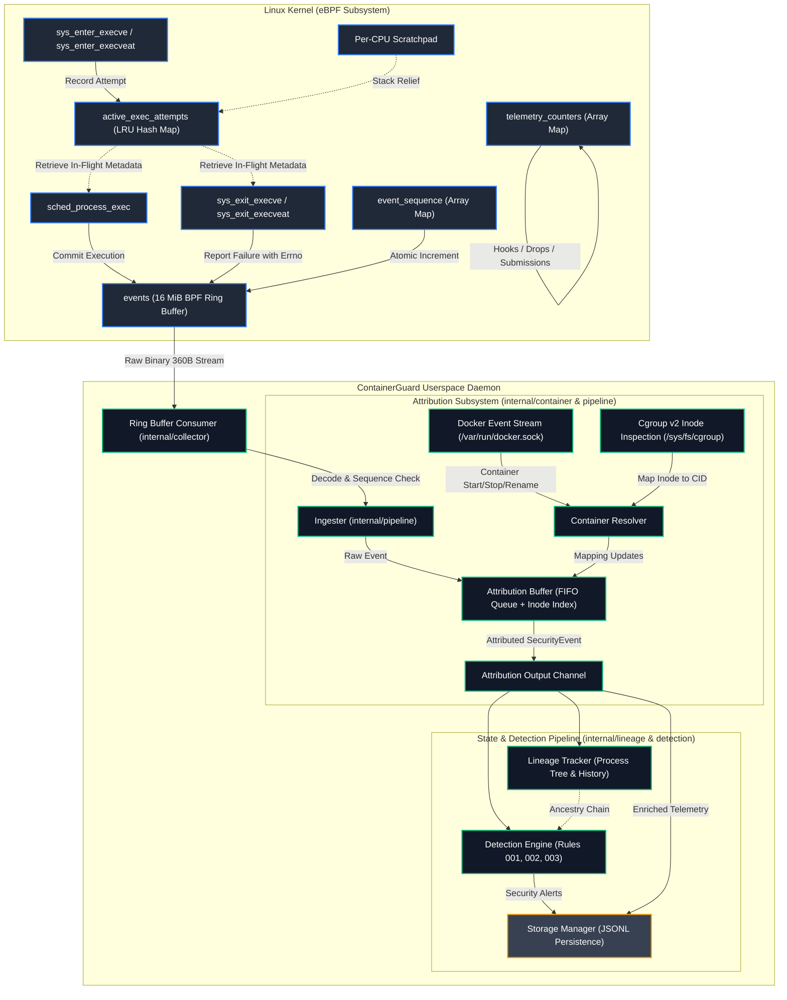
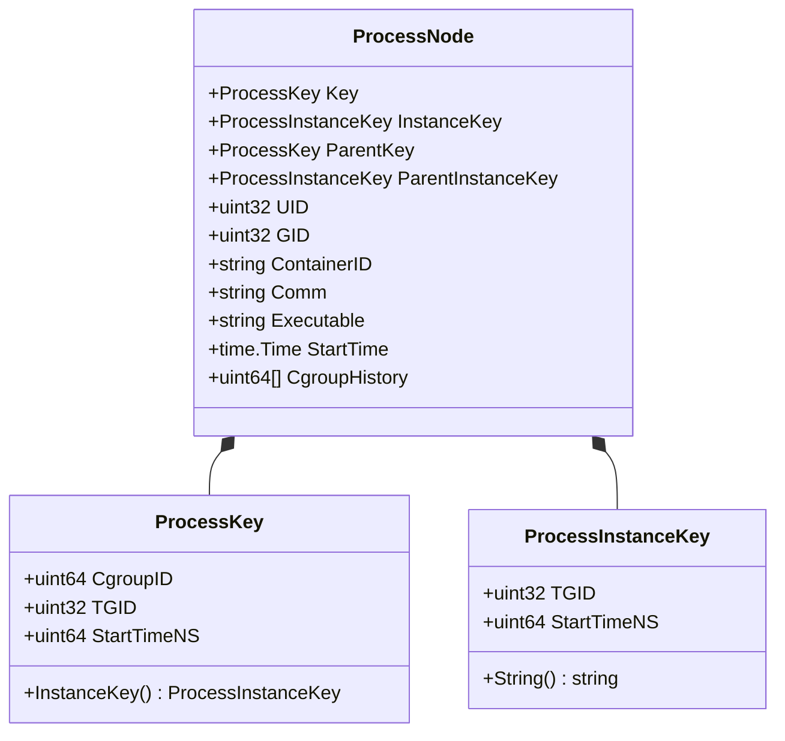
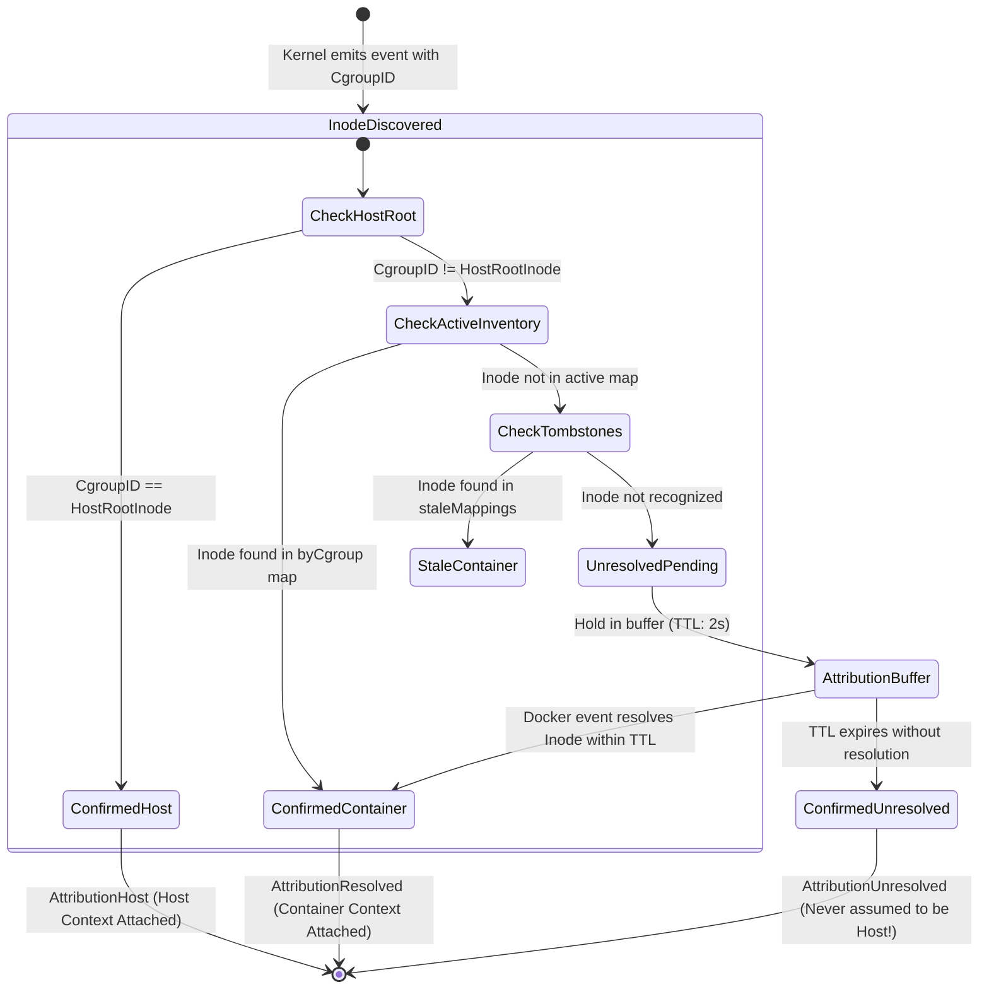
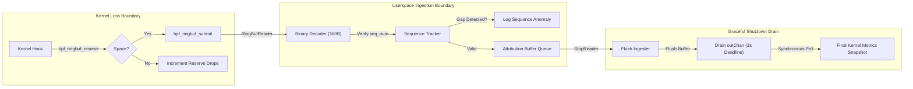
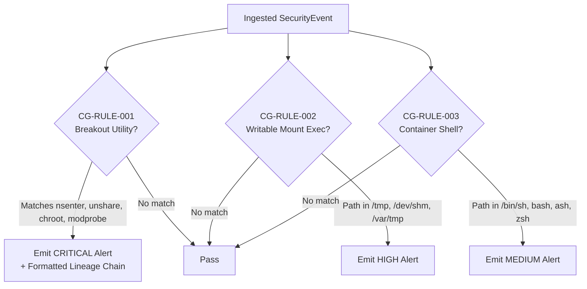

# ContainerGuard System Architecture & Engineering Design

**Release Milestone:** ContainerGuard 50% Verified Milestone  
**Target Platform:** Linux 6.x+ with BTF (Empirically verified on Linux 6.18.33.1-microsoft-standard-WSL2 / x86_64)  
**Implementation Languages:** C (eBPF CO-RE), Go 1.26.8 (Userspace Control Plane per `go.mod`)

---

## 1. Architectural Philosophy & Design Principles

ContainerGuard is designed from first principles to resolve four fundamental vulnerabilities in existing container runtime observability agents:
1. **Zero-Drop Telemetry Integrity:** Kernel-side event submission must be decoupled from userspace processing. Telemetry loss must never occur silently; drops must be explicitly measured, accounted for, and mathematically verifiable:
   $$\text{Kernel Hook Invocations} = \text{RingBuffer Submissions} + \text{Kernel Reservation Drops}$$
2. **Deterministic Process Identity Across Reboots & PID Recycling:** Linux PIDs are bounded integers (default $\le 32768$ or $\le 4194304$) subject to rapid recycling. Process identity must be decoupled from mutable execution contexts (such as PIDs and cgroup assignments) using an immutable tuple of Thread Group ID and monotonic process start time (`ProcessInstanceKey{TGID, StartTimeNS}`).
3. **Multi-Tracepoint Execution Semantics:** Intercepting execution attempts at `sys_enter_execve` alone yields false positives on failed calls and blind spots on non-standard execution pathways (`execveat`, relative dirfds, anonymous `memfd` execution). ContainerGuard correlates 5 coordinated kernel tracepoints to differentiate execution attempts, committed binary activations, and kernel-side execution failures.
4. **Explicit Attribution State Machine:** Unmapped container events must never default to host actions. Events transition through a deterministic lifecycle (`PENDING` $\to$ `RESOLVED` or `UNRESOLVED`), supported by container tombstone caching to handle asynchronous container creation races and rapid container destruction.

---

## 2. Global System Topology

The ContainerGuard architecture spans the Linux kernel boundary, bridging eBPF tracepoint hooks with a concurrent, multi-stage userspace analysis pipeline.



---

## 3. Kernel Subsystem Architecture (`bpf/execve_events.c`)

### 3.1 Tracepoint Interception Strategy
ContainerGuard coordinates 5 specific kernel tracepoints to provide comprehensive execution-path visibility across monitored execve and execveat pathways without missing failed syscalls or falling victim to namespace concealment:

> [!NOTE]
> **Kernel Compatibility & Portability Qualification:** The eBPF kernel engine is compiled with Clang using BPF CO-RE (`vmlinux.h`) and BTF type relocations. While CO-RE provides the architectural mechanism for cross-kernel struct layout portability, empirical verification has been conducted specifically on `Linux 6.18.33.1-microsoft-standard-WSL2`. Compatibility across untested upstream distributions or older kernels requires independent empirical testing.

| Tracepoint Location | Kernel Event | Purpose & Handled Semantics | Emitted Flags |
| :--- | :--- | :--- | :--- |
| `syscalls/sys_enter_execve` | `execve()` entry | Capture attempted binary path, arguments pointer, working directory, and calling process credentials. | `CG_FLAG_PATH_TRUNCATED`, `CG_FLAG_COMM_TRUNCATED` |
| `syscalls/sys_enter_execveat` | `execveat()` entry | Capture relative execution via directory file descriptor (`dfd`) or anonymous execution via `AT_EMPTY_PATH` (`0x1000`). | `CG_FLAG_EXECVEAT`, `CG_FLAG_AT_EMPTY_PATH` |
| `sched/sched_process_exec` | Binary loader committed | Triggered after kernel loader (ELF, shebang, script) succeeds and process image is replaced. Marks execution success. | `CG_FLAG_COMMITTED_EXEC`, `CG_FLAG_SETUID_EXEC` |
| `syscalls/sys_exit_execve` | `execve()` exit | Intercepts execution failures (e.g., `-2` for `ENOENT`, `-13` for `EACCES`). Emits failed execution telemetry. | `CG_FLAG_EXEC_FAILED` (exit_code < 0) |
| `syscalls/sys_exit_execveat` | `execveat()` exit | Intercepts failed relative or anonymous execution attempts with exit errno. | `CG_FLAG_EXEC_FAILED`, `CG_FLAG_EXECVEAT` |

### 3.2 Multi-Tracepoint Execution Lifecycle State Machine

```mermaid
sequenceDiagram
    autonumber
    participant App as Executing Process
    participant Enter as sys_enter_execve(at)
    participant Map as active_exec_attempts (LRU)
    participant Sched as sched_process_exec
    participant Exit as sys_exit_execve(at)
    participant RB as BPF Ring Buffer
    participant Daemon as ContainerGuard Daemon

    App->>Enter: invoke execve(pathname, argv, envp)
    activate Enter
    Enter->>Enter: Increment CG_METRIC_HOOK_CALLS
    Enter->>Enter: Read task_struct (cgroup v2 inode, parent cgroup inode, EUID)
    Enter->>Enter: Copy pathname (up to 256B) & comm into scratchpad
    Enter->>Map: Store struct exec_attempt (Key: pid_tgid)
    deactivate Enter

    alt Binary Loader Succeeds (Committed Execution)
        App->>Sched: Binary loaded into memory space
        activate Sched
        Sched->>Map: Lookup attempt by pid_tgid
        Sched->>Sched: Inspect credentials (EUID != UID -> Setuid flag)
        Sched->>RB: bpf_ringbuf_reserve(360 bytes)
        alt Ring Buffer Space Available
            Sched->>RB: bpf_ringbuf_submit(event with CG_FLAG_COMMITTED_EXEC)
            Sched->>Map: Delete attempt entry (Cleanup)
        else Buffer Saturated
            Sched->>Sched: Increment CG_METRIC_RB_RESERVE_DROPS
            Sched->>Map: Delete attempt entry
        end
        deactivate Sched
        App->>Exit: Return 0
        activate Exit
        Exit->>Exit: Ret >= 0; Attempt already consumed by Sched
        deactivate Exit
    else Kernel Loader Fails (Failed Execution)
        App->>Exit: Return negative errno (e.g. -ENOENT, -EACCES)
        activate Exit
        Exit->>Map: Lookup attempt by pid_tgid
        Exit->>RB: bpf_ringbuf_reserve(360 bytes)
        alt Ring Buffer Space Available
            Exit->>RB: bpf_ringbuf_submit(event with CG_FLAG_EXEC_FAILED, exit_code)
            Exit->>Map: Delete attempt entry (Cleanup)
        else Buffer Saturated
            Exit->>Exit: Increment CG_METRIC_RB_RESERVE_DROPS
            Exit->>Map: Delete attempt entry
        end
        deactivate Exit
    end

    RB-->>Daemon: Consume 360B binary record via mmap
```

### 3.3 BPF Memory Architecture & Map Specifications

```c
/* Enriched 360-byte kernel execution event layout (64-bit aligned) */
struct exec_event {
    __u64 timestamp_ns;         /* Offset  0: Monotonic kernel timestamp */
    __u64 cgroup_id;            /* Offset  8: Cgroup v2 inode of executing task */
    __u64 parent_cgroup_id;     /* Offset 16: Cgroup v2 inode of parent process */
    __u64 seq_num;              /* Offset 24: Monotonic per-system sequence number */
    __u64 start_time_ns;        /* Offset 32: Thread-group leader process start time */
    __u64 parent_start_time_ns; /* Offset 40: Parent leader start time */
    __u32 tid;                  /* Offset 48: Thread ID */
    __u32 tgid;                 /* Offset 52: Thread Group ID (Process PID) */
    __u32 parent_tgid;          /* Offset 56: Parent TGID (PPID) */
    __u32 uid;                  /* Offset 60: Real User ID */
    __u32 gid;                  /* Offset 64: Real Group ID */
    __u32 flags;                /* Offset 68: Operational bitmask flags */
    __s32 dfd;                  /* Offset 72: Directory FD for execveat (-100 for AT_FDCWD) */
    __u32 at_flags;             /* Offset 76: Flags for execveat (AT_EMPTY_PATH = 0x1000) */
    __s32 exit_code;            /* Offset 80: Syscall return code (0 or negative errno) */
    __u32 euid;                 /* Offset 84: Effective UID */
    char  comm[16];             /* Offset 88: Executing command comm */
    char  filename[256];        /* Offset 104: Executable absolute/relative pathname */
};
```

#### Kernel Map Registry:
1. **`events` (`BPF_MAP_TYPE_RINGBUF`):**  
   16 MiB default multi-producer, single-consumer ring buffer. Supports lockless user-space memory mapping (`mmap`), reducing overhead compared to legacy `perf_event` buffers.
2. **`active_exec_attempts` (`BPF_MAP_TYPE_LRU_HASH`, max 16,384 entries):**  
   Tracks in-flight execution attempts between syscall entry and exit/commit. The LRU eviction policy prevents memory leaks if an executing thread is terminated asynchronously before syscall completion.
3. **`attempt_scratch` (`BPF_MAP_TYPE_PERCPU_ARRAY`, 1 entry):**  
   Per-CPU scratchpad storage used to assemble in-flight attempts, completely preventing BPF verifier stack exhaustion (Linux BPF stack is limited to 512 bytes; `struct exec_attempt` is 352 bytes).
4. **`telemetry_counters` (`BPF_MAP_TYPE_ARRAY`, 4 entries):**  
   Maintains atomic 64-bit kernel telemetry metrics:
   - Index 0: `CG_METRIC_HOOK_CALLS`
   - Index 1: `CG_METRIC_RB_RESERVE_DROPS`
   - Index 2: `CG_METRIC_RB_SUBMITTED`
   - Index 3: `CG_METRIC_CGROUP_MAP_FAILS`
5. **`event_sequence` (`BPF_MAP_TYPE_ARRAY`, 1 entry):**  
   Generates a strictly monotonic 64-bit sequence number across all execution tracepoints, allowing user space to detect sequence gaps.

---

## 4. Process Identity & Lineage Architecture (`internal/lineage`)

### 4.1 Immutable Process Identity Decoupling
Traditional Linux observability tools key processes on PID or `(PID, CgroupID)`. This creates severe tracking flaws:
- **PID Recycling:** PIDs wrap around quickly under heavy execution workloads.
- **Cross-Cgroup Migration:** A container process moved into a sub-cgroup or system slice changes identity, breaking parentage.
- **Cross-Namespace Parentage:** Container runtimes (`containerd-shim`, `runc`) execute in the host cgroup, while child processes launch in container cgroups.

ContainerGuard decouples mutable execution context from immutable process instance identity:



### 4.2 Cgroup Migration Handling
When a process moves to a different cgroup (e.g. systemd slice reparenting or resource constraint adjustment):
1. `LineageTracker.RecordExec()` identifies the existing node via `ProcessInstanceKey{TGID, StartTimeNS}`.
2. If `existing.Key.CgroupID != event.CgroupID`, the migration is recorded:
   - Prior cgroup is pushed into `node.CgroupHistory`.
   - The event is flagged as `cgroup_migrated: true`.
   - The active primary key is updated without breaking parent-child links or losing historical attribution.

---

## 5. Container Identity Resolution (`internal/container`)

ContainerGuard resolves container ownership via the Linux **cgroup v2 filesystem inode**:



### 5.1 Reconciliation Logic & Tombstoning
1. **Host Inode Seeding:** At initialization, ContainerGuard queries `os.Stat("/sys/fs/cgroup")` to obtain the root cgroup inode. Any execution occurring in the root cgroup is definitively tagged as host execution.
2. **Docker Event Stream Listener:** A background worker monitors `/var/run/docker.sock` for `container create`, `start`, `die`, and `destroy` events.
3. **Cgroup Inode Inspection:** When a container starts, ContainerGuard queries the container's PID via Docker API and reads `/proc/<pid>/cgroup` (entry `0::/path`) to stat `/sys/fs/cgroup/<path>`, obtaining the true 64-bit inode.
4. **Tombstone Caching (`staleMappings`):** When a container stops, its cgroup inode mapping is moved to a tombstone cache rather than deleted immediately. Any in-flight execution events delayed in the ring buffer can still be attributed to the container that created them.
5. **Bounded Attribution Queue:** Unmapped events wait in a FIFO queue with default capacity of 10,000 items (`DefaultConfig().MaxPendingCapacity = 10000`). If unmapped after `PendingTTL` (default 2s), they transition to `UNRESOLVED` without dropping or blocking the ingestion pipeline. In empirical stress tests up to 25,000 events, peak queue depth reached was 1,371 items, well within bounded capacity.

---

## 6. Telemetry Ingestion & Loss Accounting Pipeline (`internal/pipeline`)



### Telemetry Invariant Conservation
ContainerGuard enforces exact mathematical conservation between kernel hooks and user space:
$$\text{Hook Invocations} = \text{RingBuffer Submissions} + \text{Kernel Reservation Drops}$$
- **Kernel Reservation Drops:** Occur when the BPF ring buffer is full (reader paused or overloaded). Monitored via atomic array map counter `CG_METRIC_RB_RESERVE_DROPS`.
- **Sequence Gaps:** Monitored via `seq_num` delta in `internal/pipeline/ingester.go`. A sequence gap indicates user-space event omission or packet corruption.

---

## 7. Deterministic Detection Engine (`internal/detection`)

ContainerGuard executes three deterministic detection rules against every ingested event:



- **`CG-RULE-001` (Privileged Container Breakout Utility):** Triggers when an executable matching breakout utilities (`nsenter`, `unshare`, `capsh`, `chroot`, `modprobe`, `insmod`) is executed inside a resolved or pending container.
- **`CG-RULE-002` (Execution from Writable Mount):** Triggers when an executable is launched from volatile or world-writable directories (`/tmp/`, `/dev/shm/`, `/var/tmp/`) inside a resolved container.
- **`CG-RULE-003` (Container Shell Binary Spawned):** Triggers when an interactive shell interpreter (`/bin/sh`, `/bin/bash`, `/bin/dash`, `/bin/ash`, `/bin/zsh`) is executed inside a resolved container. (Note: evaluates executable path; terminal interactivity is not evaluated in the 50% milestone).

---

## 8. Graceful Shutdown & Synchronous Metrics Drain

To prevent race conditions during daemon termination:
1. **Reader Termination (`StopReader()`):** The userspace ring buffer reader is unblocked and stopped, preventing new events from entering the ingestion channel while leaving BPF maps fully accessible.
2. **Ingester Sequence Flush (`ingester.Flush()`):** Emits any pending sequence anomalies.
3. **Attribution Buffer Flush (`buffer.Flush()`):** Force-expires any events remaining in the pending queue to `UNRESOLVED`, pushing them to `outChan` without dropping.
4. **Synchronous Channel Drain:** The daemon drains all remaining events from `outChan` to disk within a 3-second deadline.
5. **Synchronous Kernel Metrics Query:** Only after all events have drained does the daemon query `telemetry_counters` from the kernel, ensuring that kernel counters exactly match the processed event records.

---
*ContainerGuard 50% Verified Milestone Architecture Specification*
