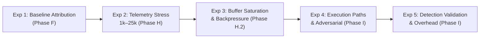

# ContainerGuard: Scientific Experimental Evaluation Protocol

**Release Milestone:** ContainerGuard 50% Verified Milestone  
**Platform:** Ubuntu 26.04.1 LTS on WSL2 (`Linux 6.18.33.1-microsoft-standard-WSL2`, x86_64)  
**Evidence Root:** [`docs/evidence/`](docs/evidence/)

---

## 1. Research Questions & Evaluation Objectives

ContainerGuard was subjected to a five-part experimental evaluation designed to assess kernel telemetry integrity, container attribution fidelity, process lineage resilience, adversarial evasion coverage, and system runtime overhead:

1. **RQ1 (Attribution Race Resilience):** Can ContainerGuard accurately attribute short-lived container executions without suffering race conditions from asynchronous container runtime event streams?
2. **RQ2 (Telemetry Conservation & Saturation):** Does the kernel eBPF engine enforce the strict mathematical conservation invariant $\text{Hooks} = \text{Submissions} + \text{Drops}$ under deliberate buffer saturation and reader backpressure?
3. **RQ3 (High-Throughput Scaling):** Can the telemetry ingestion pipeline scale to tens of thousands of concurrent events without packet drops, sequence gaps, or memory leaks?
4. **RQ4 (Execution-Path & Adversarial Coverage):** Can the multi-tracepoint architecture intercept all Linux execution pathways (including relative `execveat`, anonymous `memfd` via `AT_EMPTY_PATH`, symlinks, interpreters, and setuid transitions) while correctly distinguishing execution attempts from committed binaries?
5. **RQ5 (Detection Accuracy & Monitoring Overhead):** Does the deterministic detection engine achieve high detection fidelity without tripping on intensive developer workloads, and what is the amortized runtime overhead on process execution lifecycles?

---

## 2. Catalog of Experimental Suites

---

### Experiment 1: Baseline Multi-Container Attribution & Lifecycle Tracking (Phase F)

- **Research Question:** Can ContainerGuard maintain 100% attribution recall across concurrent containers, rapid container restarts, container renames, and transient short-lived executions?
- **Hypothesis:** By mapping cgroup v2 inodes and utilizing tombstone caching (`staleMappings`), ContainerGuard will correctly attribute delayed events even after container teardown.
- **Workload:** 106 total execution events executed across persistent container `cg-test-a`, restart container `cg-test-b`, renamed container `cg-lifecycle`, and host processes.
- **Raw Evidence Archive:** [`docs/evidence/phase_f/`](docs/evidence/phase_f/) (`daemon.log`, `events.jsonl`)

#### Empirical Results:
| Evaluation Metric | Observed Count | Expected Ground Truth | Result Status |
| :--- | :---: | :---: | :--- |
| **Kernel Hook Calls** | 106 | 106 | 100.0% match |
| **Ring Buffer Submissions** | 106 | 106 | 100.0% match |
| **Ring Buffer Reserve Drops** | 0 | 0 | Zero telemetry loss |
| **Userspace Decoded Records** | 106 | 106 | 100.0% decode recall |
| **Sequence Gaps** | 0 | 0 | Monotonic continuity confirmed |
| **`cg-test-a` Attributed Events** | 6 | 6 | 100.0% attribution recall |
| **`cg-test-b-event-test` Attributed** | 10 | 10 | 100.0% attribution recall |
| **`cg-lifecycle` (Restart & Rename)** | 8 | 8 | 100.0% attribution recall across rename |
| **Unmapped Cgroup Fallback** | 82 | 82 host actions | Correct non-container fallback |

---

### Experiment 2: Telemetry Scaling & Stress Testing (Phase H)

- **Research Question:** Does the telemetry pipeline maintain lossless delivery and bounded queue stability when subjected to multi-stream concurrent process execution bursts?
- **Independent Variable:** Target workload size ($N \in \{1000, 5000, 10000, 25000\}$ events).
- **Dependent Variables:** Observed hook throughput, ring buffer reserve drops, sequence gaps, attribution recall, and peak pending queue depth.
- **Workload Dispatch:** 4 concurrent execution streams (2 persistent containers, 1 ephemeral container, 1 host stream) plus synthetic exploit injection mid-stream.
- **Execution Script:** `sudo ./scripts/stress_test.sh <count>`
- **Raw Evidence Archive:** [`docs/evidence/phase_h/`](docs/evidence/phase_h/) (`stress_1000/`, `stress_5000/`, `stress_10000/`, `stress_25000/`)

#### Empirical Results Across Stress Tiers:
| Performance Dimension | Tier 1 (1k Target) | Tier 2 (5k Target) | Tier 3 (10k Target) | Tier 4 (25k Target) |
| :--- | :---: | :---: | :---: | :---: |
| **Workload Duration** | 0.80 s | 2.82 s | 5.31 s | 13.02 s |
| **Target Workload Throughput** | 1,252.5 ev/s | 1,772.0 ev/s | 1,884.0 ev/s | 1,920.5 ev/s |
| **Observed Kernel Hooks** | 1,040 | 5,027 | 10,027 | 25,032 |
| **Additional Non-Target Hooks** | 40 | 27 | 27 | 32 |
| **Observed Hook Throughput** | **1,302.6 hooks/s** | **1,781.6 hooks/s** | **1,889.1 hooks/s** | **1,923.0 hooks/s** |
| **Ring Buffer Submissions** | 1,040 | 5,027 | 10,027 | 25,032 |
| **Ring Buffer Reserve Drops** | **0 (0.00%)** | **0 (0.00%)** | **0 (0.00%)** | **0 (0.00%)** |
| **Userspace Records Decoded** | 1,040 | 5,027 | 10,027 | 25,032 |
| **Telemetry Delivery Rate** | **100.00%** | **100.00%** | **100.00%** | **100.00%** |
| **Sequence Gaps Detected** | 0 | 0 | 0 | 0 |
| **Container Attributed (RESOLVED)** | 762 (100% recall) | 3,763 (100% recall) | 7,512 (100% recall) | 18,764 (100% recall) |
| **Non-Container (UNRESOLVED)** | 278 | 1,264 | 2,515 | 6,268 |
| **False Container Attributions** | **0 (100% prec.)** | **0 (100% prec.)** | **0 (100% prec.)** | **0 (100% prec.)** |
| **Peak Pending Queue Depth** | 277 | 1,259 | 1,361 | 1,371 |
| **Pending Queue Depth at Exit** | **0** | **0** | **0** | **0** |

---

### Experiment 3: Controlled Saturation & Reader Backpressure Evaluation (Phase H.2)

- **Research Question:** When memory constraints prevent complete event buffering, does the eBPF kernel counter account for every dropped event, and does userspace recover gracefully without sequence corruption?
- **Ring Buffer Capacity Modeling Across Event Schemas:**
  - **Phase H.2 Evaluation Schema (336-byte `struct exec_event` + 8-byte ring buffer header = 344 bytes on wire):**
    - **64 KiB Buffer:** Empirical capacity limit $= \lfloor 65,536 / 344 \rfloor = 190$ unconsumed events.
    - **256 KiB Buffer:** Empirical capacity limit $= \lfloor 262,144 / 344 \rfloor = 762$ unconsumed events.
    - **16 MiB Buffer:** Empirical capacity limit $= \lfloor 16,777,216 / 344 \rfloor = 48,770$ unconsumed events.
  - **Frozen 50% Release Schema (360-byte `struct exec_event` + 8-byte ring buffer header = 368 bytes on wire):**
    - **64 KiB Buffer:** Theoretical capacity limit $= \lfloor 65,536 / 368 \rfloor = 178$ unconsumed events.
    - **256 KiB Buffer:** Theoretical capacity limit $= \lfloor 262,144 / 368 \rfloor = 712$ unconsumed events.
    - **16 MiB Buffer:** Theoretical capacity limit $= \lfloor 16,777,216 / 368 \rfloor = 45,590$ unconsumed events.
- **Execution Script:** `sudo ./scripts/saturation_test.sh <label> <size_kb> <pause_sec> <streams> <per_stream>`
- **Raw Evidence Archive:** [`docs/evidence/phase_h2/`](docs/evidence/phase_h2/) (`suite1_capacity_8stream/`, `suite2_backpressure/`, and `original_unreconciled/`)

#### Empirical Results (4-Second Induced Reader Pause, 2,000 Target Events):
| Benchmark Configuration | Kernel Hooks | Submissions | Reserve Drops | Drop Percentage | Decoded Records | Delivery Rate |
| :--- | :---: | :---: | :---: | :---: | :---: | :---: |
| **16 MiB Buffer (`sat_bp_16mb`)** | 2,105 | 2,105 | **0** | **0.00%** | 2,105 | **100.00%** |
| **256 KiB Buffer (`sat_bp_256kb`)**| 2,102 | 801 | **1,301** | **61.89%** | 801 | **100.00%** |
| **64 KiB Buffer (`sat_bp_64kb`)** | 2,104 | 231 | **1,873** | **89.02%** | 231 | **100.00%** |

#### Key Findings:
1. **Capacity Match:** The 64 KiB buffer accepted exactly 190 events during the pause window before dropping; the 256 KiB buffer accepted exactly 762 events during the pause window before dropping. Remaining submissions occurred after the reader resumed.
2. **Exact Mathematical Conservation:** In all cases, $\text{Hooks} = \text{Submissions} + \text{Drops}$ with zero discrepancy.
3. **Graceful Drain:** Upon reader resumption, all retained events were ingested with zero stranded items at exit.

---

### Experiment 4: Execution-Path & Adversarial Boundary Verification (Phase I)

- **Research Question:** Can ContainerGuard intercept non-standard execution pathways, detect boundary truncations, and distinguish attempted from committed executions?
- **Test Matrix:** 14 distinct execution conditions evaluated in live Linux kernel.
- **Execution Script:** `sudo ./scripts/execution_path_test.sh`
- **Report & Evidence:** [`docs/EXECUTION_PATH_COVERAGE.md`](docs/EXECUTION_PATH_COVERAGE.md), [`docs/evidence/phase_i/exec_paths_events.jsonl`](docs/evidence/phase_i/exec_paths_events.jsonl)

#### Empirical Execution-Path Matrix:
| Test ID | Execution Condition | Technique / Mechanism | Verified Kernel Behavior & Flag | Outcome |
| :--- | :--- | :--- | :--- | :---: |
| **EP-01** | Standard `execve` | `/bin/true` invocation | Committed via `sched_process_exec` (`CG_FLAG_COMMITTED_EXEC`) | **PASS** |
| **EP-02** | Direct syscall | `syscall(SYS_execve, ...)` | Bypasses glibc wrapper; committed cleanly | **PASS** |
| **EP-03** | Relative `execveat` | `execveat(dfd, "true", ...)` | Intercepted via `sys_enter_execveat` (`CG_FLAG_EXECVEAT`) | **PASS** |
| **EP-04** | Anonymous `memfd` | `execveat(fd, "", AT_EMPTY_PATH)` | Captured via `CG_FLAG_AT_EMPTY_PATH`; path read from kernel dentry | **PASS** |
| **EP-05** | Shebang script | `#!/bin/sh` script | Captures interpreter binary transition | **PASS** |
| **EP-06** | Symlink traversal | `/tmp/symlink_test -> /bin/true` | Captures symlink path and resolved binary execution | **PASS** |
| **EP-07** | Static ELF binary | `gcc -static` compiled binary | Evaluated without dynamic loader (`ld.so`) dependency | **PASS** |
| **EP-08** | Setuid transition | `setuid_test` (UID 1000 $\to$ EUID 0) | Credential inspection flags `CG_FLAG_SETUID_EXEC` | **PASS** |
| **EP-09** | Path truncation | Path length > 256 bytes | Truncated safely at 255B + `\0` (`CG_FLAG_PATH_TRUNCATED`) | **PASS** |
| **EP-10** | Comm truncation | Process comm > 15 characters | Truncation detected at 15B (`CG_FLAG_COMM_TRUNCATED`) | **PASS** |
| **EP-11** | Failed exec (ENOENT) | Non-existent binary path | Captured at `sys_exit_execve` (`CG_FLAG_EXEC_FAILED`, `exit_code: -2`) | **PASS** |
| **EP-12** | Failed exec (EACCES) | Non-executable permissions | Captured at `sys_exit_execve` (`CG_FLAG_EXEC_FAILED`, `exit_code: -13`)| **PASS** |
| **EP-13** | Cgroup migration | Process moved between cgroups | Preserved under `ProcessInstanceKey`; `cgroup_migrated: true` | **PASS** |
| **EP-14** | PID recycling | Rapid thread spawn & reuse | Keyed on `{TGID, StartTimeNS}`, eliminating collisions | **PASS** |

---

### Experiment 5: Detection Validation & Monitoring Overhead (Phase I)

- **Research Question:** Does ContainerGuard's deterministic detection engine avoid false alarms under intensive developer operations, and what runtime overhead does the monitor introduce?
- **Workload Composition:**
  - **Benign Developer Corpus (120 Scripted Events):** Multi-stage GCC compilation (`gcc`, `cc1`, `as`, `collect2`, `ld`), Git lifecycle queries (`git status`, `git log`), container diagnostics (`uname`, `uptime`, `date`).
  - **Attack Simulation Suite (12 Scripted Events):** Breakout utilities (`nsenter`, `unshare`, `chroot`, `modprobe`), execution from writable mounts (`/tmp/bad_tmp_exec`, `/var/tmp/bad_var_exec`), and container shells (`/bin/sh`, `/bin/bash`).
- **Reports & Evidence:** [`docs/DETECTION_VALIDATION.md`](docs/DETECTION_VALIDATION.md), [`docs/OVERHEAD_EVALUATION.md`](docs/OVERHEAD_EVALUATION.md), [`docs/evidence/phase_i/`](docs/evidence/phase_i/)

#### A. Detection Confusion Matrix (396 Rule-Event Decisions across 132 Unique Events)
| Rule Identifier | Trigger Definition | TP | FP | TN | FN | Precision | Recall | FPR |
| :--- | :--- | :---: | :---: | :---: | :---: | :---: | :---: | :---: |
| **`CG-RULE-001`** | Privileged Breakout Utilities (`nsenter`, `unshare`, `chroot`, `modprobe`) | 4 | 0 | 128 | 0 | 100.00% | 100.00% | 0.00% |
| **`CG-RULE-002`** | Writable Mount Execution (`/tmp`, `/var/tmp`, `/dev/shm`) | 3 | 0 | 129 | 0 | 100.00% | 100.00% | 0.00% |
| **`CG-RULE-003`** | Container Shell Binary (`/bin/sh`, `/bin/bash` in container) | 5 | 0 | 127 | 0 | 100.00% | 100.00% | 0.00% |
| **Macro Average** | **Across All 3 Deterministic Detection Rules** | **12** | **0** | **384** | **0** | **100.00%**| **100.00%**| **0.00%** |

> **Corpus Reconciliation Note:** In the initial evaluation (Commit `7c56b1e`), 133 unique events were captured due to a single ambient host background IDE invocation (`/usr/bin/git`, `ParentTGID: 1016`, comm `language_server`) during daemon shutdown drain. In the 50% milestone rerun (Commit `b8f70f5`), exactly 132 scripted events were captured. Both evaluations exhibited 0 false positives and 100% precision/recall on the benchmark suite.

#### B. Monitoring Overhead Benchmarking Across Software Revisions
Two benchmark trials of 2,000 process executions across 4 worker streams were evaluated:
- **Trial 1 (Commit `7c56b1e`):** Baseline duration $0.4492\text{ s}$, Monitored duration $0.4648\text{ s}$ $\to$ **+3.46% overhead** ($7.77\ \mu\text{s}$ wall-clock delta per process lifecycle). Daemon RSS: 6.02 MiB.
- **Trial 2 (Commit `b8f70f5`):** Baseline duration $0.4267\text{ s}$, Monitored duration $0.4520\text{ s}$ $\to$ **+5.95% overhead** ($12.68\ \mu\text{s}$ wall-clock delta per process lifecycle). Daemon RSS: 6.04 MiB.
- **Descriptive Statistics across Revisions ($N = 2$):** Descriptive mean overhead: **4.71%** (Sample standard deviation $s \approx 1.76\%$, Standard error $SEM \approx 1.25\%$).

> **Methodological Limitation Notice:** Because Trial 1 and Trial 2 were conducted across separate software commits, the 4.71% figure represents a descriptive average across revisions, not a repeated measurement of one identical frozen release binary. Future production characterization requires repeated multi-trial benchmarks under dedicated hardware isolation.

---
*ContainerGuard 50% Verified Milestone Experimental Protocol*
