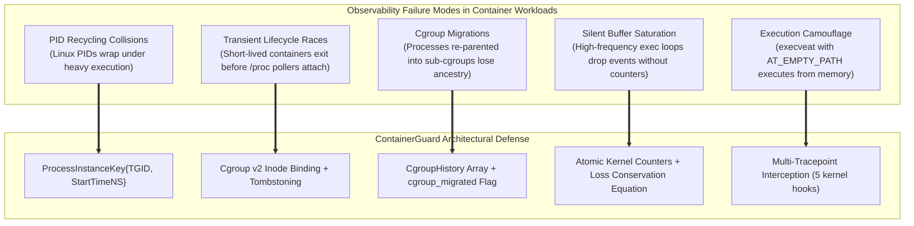
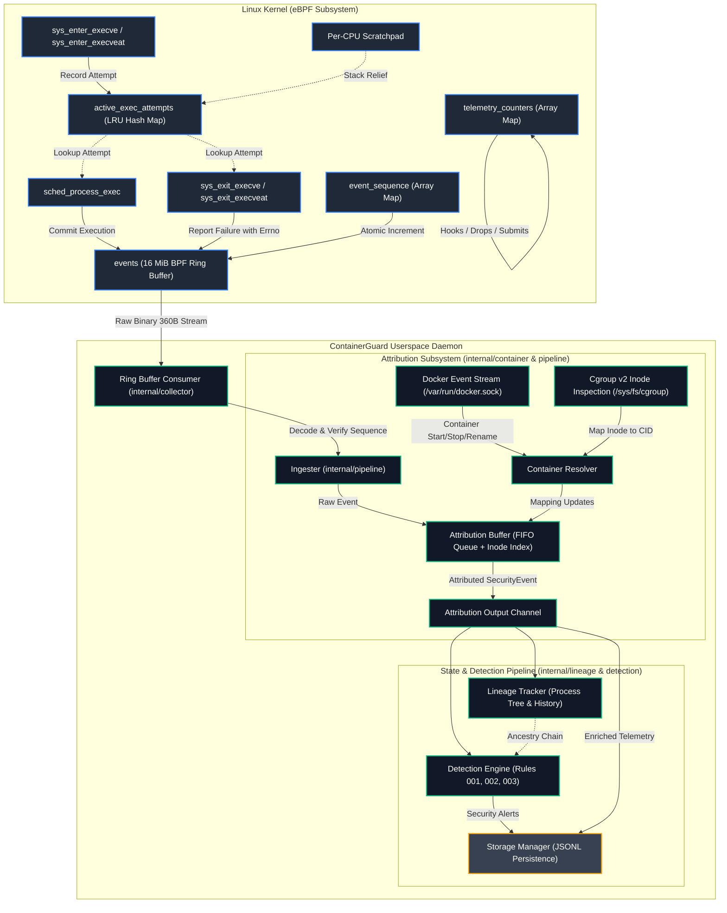
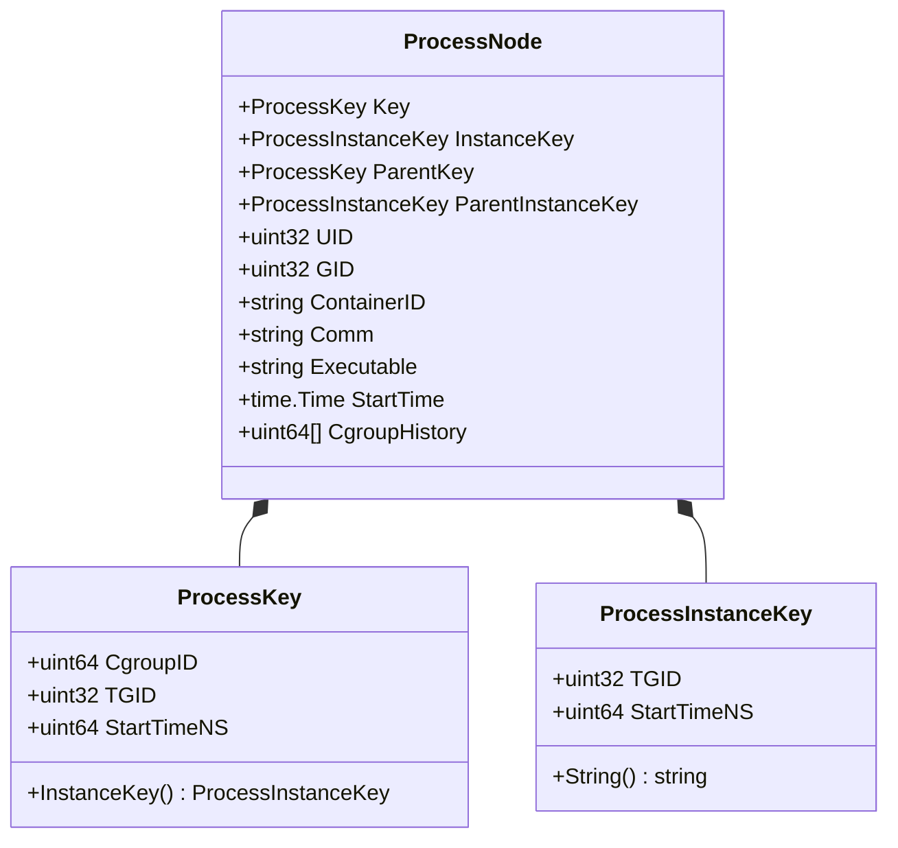
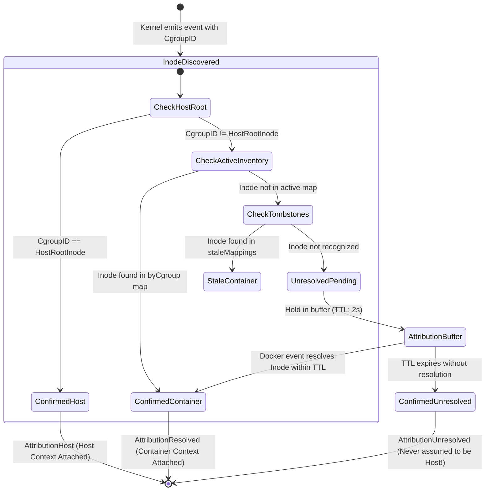
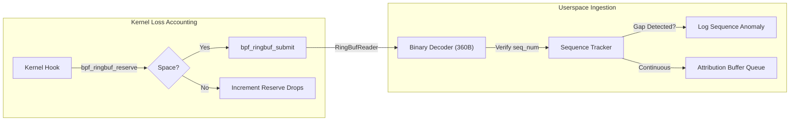
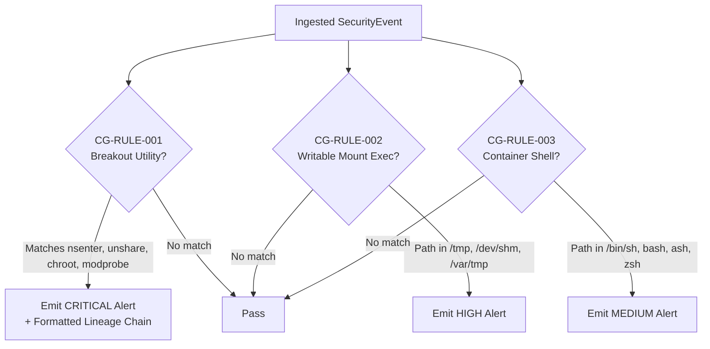

# ContainerGuard

### Resilient eBPF-Based Runtime Intrusion Detection for Linux Containers

[](docs/MILESTONE_50_PERCENT_ACCEPTANCE_REPORT.md)
[-orange?style=for-the-badge)](https://www.kernel.org/)
[](https://docs.kernel.org/bpf/ringbuf.html)
[](https://go.dev/)
[](#roadmap-and-development-status)

```text
========================================================================================================
 MILESTONE STATUS: 50% Verified Milestone Checkpoint | Commit: b8f70f5 | Phase II Not Started
========================================================================================================
```

ContainerGuard is an eBPF-based runtime security and container telemetry architecture engineered to provide **resilient container workload attribution (with explicit unresolved state handling)**, **loss-aware kernel telemetry**, and **high-fidelity execution-path monitoring** for Linux container environments.

The project investigates fundamental systems security challenges in container observability:
- **Telemetry Integrity Under Saturation:** Accounting for kernel-side buffer drops and maintaining exact mathematical conservation:
  $$\text{Kernel Hook Invocations} = \text{Ring Buffer Submissions} + \text{Kernel Reservation Drops}$$
- **Decoupled Process Instance Identity:** Neutralizing PID recycling and cgroup reassignment attacks via immutable `ProcessInstanceKey{TGID, StartTimeNS}` tracking.
- **Execution-Path Semantics:** Correlating 5 coordinated kernel tracepoints to differentiate execution attempts, committed binary activations, and kernel-side execution failures across standard `execve`, relative `execveat`, and anonymous `memfd` invocations.
- **Deterministic Attribution:** Mapping cgroup v2 filesystem inodes directly to container runtime lifecycle metadata with tombstone caching, avoiding the race conditions of asynchronous container destruction.

---

## Table of Contents
1. [Executive Overview](#1-executive-overview)
2. [The Runtime Observability Challenge](#2-the-runtime-observability-challenge)
3. [Research Objectives & Implemented Scope](#3-research-objectives--implemented-scope)
4. [System Architecture](#4-system-architecture)
5. [eBPF Kernel Telemetry Internals](#5-ebpf-kernel-telemetry-internals)
6. [Process Identity & Lineage Architecture](#6-process-identity--lineage-architecture)
7. [Container Identity Resolution](#7-container-identity-resolution)
8. [Telemetry Integrity & Loss Accounting](#8-telemetry-integrity--loss-accounting)
9. [Deterministic Detection Engine](#9-deterministic-detection-engine)
10. [Empirical Experimental Results](#10-empirical-experimental-results)
11. [System Requirements & Prerequisites](#11-system-requirements--prerequisites)
12. [Build, Installation & Execution](#12-build-installation--execution)
13. [Configuration & Telemetry Schemas](#13-configuration--telemetry-schemas)
14. [Repository Directory Structure](#14-repository-directory-structure)
15. [Security Model & Threat Considerations](#15-security-model--threat-considerations)
16. [Explicit Limitations](#16-explicit-limitations)
17. [Research Contributions](#17-research-contributions)
18. [Reproducibility & Evidence Index](#18-reproducibility--evidence-index)
19. [Roadmap & Development Status](#19-roadmap--development-status)
20. [Primary Technical References](#20-primary-technical-references)

---

## 1. Executive Overview

Modern container monitoring architectures commonly suffer from severe architectural blind spots:
- They sample `/proc` periodically, missing short-lived evasion processes.
- They rely on mutable PIDs, leading to false parentage attribution during rapid PID recycling.
- They default unmapped container events to host processes.
- When high-volume execution bursts saturate kernel buffers, they drop events silently, leaving security teams unaware that telemetry was lost.

ContainerGuard addresses these failure modes through an in-kernel eBPF architecture coupled with a concurrent userspace pipeline. Every process execution is intercepted at kernel tracepoint boundaries, enriched with cgroup v2 filesystem inodes, assigned an immutable monotonic sequence number, and transferred to user space via an eBPF Ring Buffer. In user space, ContainerGuard reconciles events against the Docker engine event stream, resolves full process lineage, evaluates deterministic detection rules, and continuously verifies telemetry delivery against kernel eBPF array map counters.

---

## 2. The Runtime Observability Challenge

Deploying security monitoring inside containerized Linux hosts introduces unique technical complexities:



1. **PID Recycling:** In container hosts executing thousands of micro-tasks, the operating system recycles bounded integer process identifiers (governed by `/proc/sys/kernel/pid_max` and container namespace boundaries). A naive lineage tracker that keys processes on PID will attribute actions of a newly spawned process to a dead ancestor process.
2. **Ephemeral Containers:** Attackers spin up disposable containers that execute malicious commands within 50 ms and exit immediately. Standard user-space pollers querying `/proc` or container APIs miss these ephemeral lifecycles entirely.
3. **Cgroup Reassignment:** Workload schedulers, systemd slices, and resource limit adjustments frequently move executing processes between cgroups. Traditional tools treat this as a new process or lose the ancestry chain.
4. **Silent Buffer Drops:** When an adversary executes an execution flood to blind the monitoring system, standard tracing buffers overflow silently. Security teams cannot distinguish between "no malicious activity occurred" and "malicious activity was concealed within dropped event buffers."

---

## 3. Research Objectives & Implemented Scope

The ContainerGuard project is strictly partitioned into two 50% development phases. The current repository represents the **verified, frozen 50% milestone**:

### Implemented & Empirically Validated (The 50% Milestone Scope)
- [x] **eBPF Execution Telemetry Engine:** CO-RE compliant kernel probes attached to 5 execution tracepoints.
- [x] **Multi-Tracepoint Execution Coverage:** Coverage of standard `execve`, direct syscalls, relative `execveat`, anonymous `memfd` execution via `AT_EMPTY_PATH`, symlink chains, static ELF binaries, and setuid transitions.
- [x] **Execution Semantics Differentiation:** Differentiation between execution attempts, committed binaries (`sched_process_exec`), and failed executions (`sys_exit_execve` with negative errno).
- [x] **Ring Buffer Loss Accounting:** Atomic in-kernel counters tracking hooks, ring buffer reservations, and drops, satisfying:  
  $$\text{Hooks} = \text{Submissions} + \text{Drops}$$
- [x] **Decoupled Process Identity:** Immutable `ProcessInstanceKey{TGID, StartTimeNS}` preserving identity across PID reuse and cgroup migrations.
- [x] **Container Discovery & Attribution:** Real-time container inventory resolution via Docker event streams and cgroup v2 inode mapping.
- [x] **Tombstone Caching:** Graceful delayed attribution for events arriving after container termination or container renaming.
- [x] **Deterministic Rule Engine:** Real-time detection across three deterministic rules (`CG-RULE-001`, `CG-RULE-002`, `CG-RULE-003`).
- [x] **Graceful Shutdown & Synchronous Drain:** Deterministic buffer flush ensuring zero stranded queue items at daemon exit.
- [x] **Comprehensive Benchmark Evaluation:** Stress tested up to 25,000 events, saturated under 4-second reader backpressure, validated against a 132-event labelled corpus, and benchmarked for runtime overhead.

### Explicitly Excluded (Future Scope / Phase II — Not Started)
- [ ] **LSM Inline Syscall Blocking:** ContainerGuard is an *intrusion detection* and *telemetry verification* system; it does not block execution via LSM hooks.
- [ ] **Network Socket Correlation:** Network packet and socket lifecycle correlation is not implemented.
- [ ] **Interactive Terminal Inspection:** Rule `CG-RULE-003` detects shell binary paths (`/bin/sh`, `/bin/bash`), but does not evaluate pty/tty interactivity.
- [ ] **Distributed Multi-Host Aggregation:** Telemetry is processed and persisted locally in JSONL format.

---

## 4. System Architecture

ContainerGuard bridges the Linux kernel boundary through an asynchronous, memory-mapped data pipeline:



### Process Event Execution Lifecycle
```mermaid
sequenceDiagram
    autonumber
    participant App as Executing Process
    participant Enter as sys_enter_execve(at)
    participant Map as active_exec_attempts (LRU)
    participant Sched as sched_process_exec
    participant Exit as sys_exit_execve(at)
    participant RB as BPF Ring Buffer
    participant Daemon as ContainerGuard Daemon

    App->>Enter: invoke execve(pathname, argv, envp)
    activate Enter
    Enter->>Enter: Increment CG_METRIC_HOOK_CALLS
    Enter->>Enter: Extract cgroup v2 inode & parent cgroup inode via BPF CO-RE
    Enter->>Enter: Copy pathname (up to 256B) & comm into scratchpad
    Enter->>Map: Store struct exec_attempt (Key: pid_tgid)
    deactivate Enter

    alt Binary Loader Succeeds (Committed Execution)
        App->>Sched: Binary loaded into memory space
        activate Sched
        Sched->>Map: Lookup attempt by pid_tgid
        Sched->>Sched: Inspect credentials (cur_task->cred->euid != uid -> Setuid flag)
        Sched->>RB: bpf_ringbuf_reserve(360 bytes)
        alt Ring Buffer Space Available
            Sched->>RB: bpf_ringbuf_submit(event with CG_FLAG_COMMITTED_EXEC)
            Sched->>Map: Delete attempt entry (Cleanup)
        else Buffer Saturated
            Sched->>Sched: Increment CG_METRIC_RB_RESERVE_DROPS
            Sched->>Map: Delete attempt entry
        end
        deactivate Sched
        App->>Exit: Return 0
        activate Exit
        Exit->>Exit: Ret >= 0; Attempt already consumed by Sched
        deactivate Exit
    else Kernel Loader Fails (Failed Execution)
        App->>Exit: Return negative errno (e.g. -ENOENT, -EACCES)
        activate Exit
        Exit->>Map: Lookup attempt by pid_tgid
        Exit->>RB: bpf_ringbuf_reserve(360 bytes)
        alt Ring Buffer Space Available
            Exit->>RB: bpf_ringbuf_submit(event with CG_FLAG_EXEC_FAILED, exit_code)
            Exit->>Map: Delete attempt entry (Cleanup)
        else Buffer Saturated
            Exit->>Exit: Increment CG_METRIC_RB_RESERVE_DROPS
            Exit->>Map: Delete attempt entry
        end
        deactivate Exit
    end

    RB-->>Daemon: Consume 360B binary record via mmap
```

---

## 5. eBPF Kernel Telemetry Internals

ContainerGuard's kernel engine ([`bpf/execve_events.c`](bpf/execve_events.c)) is compiled with Clang/LLVM using CO-RE (`#include "vmlinux.h"`). It uses BTF type relocations to ensure binary portability across kernel patch versions.

### 5.1 Enriched 360-Byte Binary Event Layout
The kernel telemetry event structure is 64-bit aligned and occupies exactly 360 bytes on the wire:

```c
struct exec_event {
    __u64 timestamp_ns;         /* Offset   0: Monotonic kernel timestamp */
    __u64 cgroup_id;            /* Offset   8: Cgroup v2 inode of executing task */
    __u64 parent_cgroup_id;     /* Offset  16: Cgroup v2 inode of parent process */
    __u64 seq_num;              /* Offset  24: Monotonic sequence number */
    __u64 start_time_ns;        /* Offset  32: Thread-group leader start time */
    __u64 parent_start_time_ns; /* Offset  40: Parent leader start time */
    __u32 tid;                  /* Offset  48: Thread ID */
    __u32 tgid;                 /* Offset  52: Thread Group ID (Process PID) */
    __u32 parent_tgid;          /* Offset  56: Parent TGID (PPID) */
    __u32 uid;                  /* Offset  60: Real User ID */
    __u32 gid;                  /* Offset  64: Real Group ID */
    __u32 flags;                /* Offset  68: Operational bitmask flags */
    __s32 dfd;                  /* Offset  72: Directory FD for execveat (-100 for AT_FDCWD) */
    __u32 at_flags;             /* Offset  76: Flags for execveat (AT_EMPTY_PATH = 0x1000) */
    __s32 exit_code;            /* Offset  80: Syscall return code (0 or negative errno) */
    __u32 euid;                 /* Offset  84: Effective UID */
    char  comm[16];             /* Offset  88: Executing command comm */
    char  filename[256];        /* Offset 104: Executable absolute/relative pathname */
};
```

### 5.2 BPF Maps Registry
- **`events` (`BPF_MAP_TYPE_RINGBUF`, 16 MiB default):** Primary data channel. BPF ring buffers provide lockless, multi-core concurrent submissions with memory-mapped zero-copy consumer reads.
- **`active_exec_attempts` (`BPF_MAP_TYPE_LRU_HASH`, max 16,384 entries):** Correlates `sys_enter` metadata with subsequent `sched_process_exec` or `sys_exit` events. The LRU policy guarantees that threads killed asynchronously mid-syscall do not leak kernel memory.
- **`attempt_scratch` (`BPF_MAP_TYPE_PERCPU_ARRAY`, 1 entry):** Per-CPU scratchpad memory. Prevents BPF stack overflow (the BPF verifier limits stack memory to 512 bytes; `struct exec_attempt` is 352 bytes).
- **`telemetry_counters` (`BPF_MAP_TYPE_ARRAY`, 4 entries):** Atomic kernel counters tracking:
  - `CG_METRIC_HOOK_CALLS` (Index 0)
  - `CG_METRIC_RB_RESERVE_DROPS` (Index 1)
  - `CG_METRIC_RB_SUBMITTED` (Index 2)
  - `CG_METRIC_CGROUP_MAP_FAILS` (Index 3)
- **`event_sequence` (`BPF_MAP_TYPE_ARRAY`, 1 entry):** Atomic 64-bit sequence counter ensuring continuous event stream integrity.

### 5.3 Operational Bitmask Flags
```c
#define CG_FLAG_START_TIME_ESTIMATED        (1 << 0)
#define CG_FLAG_PARENT_START_TIME_ESTIMATED (1 << 1)
#define CG_FLAG_PATH_TRUNCATED              (1 << 2) /* Path exceeded 256 bytes */
#define CG_FLAG_COMM_TRUNCATED              (1 << 3) /* Comm exceeded 15 bytes */
#define CG_FLAG_EXECVEAT                    (1 << 4) /* Invoked via execveat syscall */
#define CG_FLAG_AT_EMPTY_PATH               (1 << 5) /* Anonymous memfd execution */
#define CG_FLAG_COMMITTED_EXEC              (1 << 6) /* Successful execution */
#define CG_FLAG_EXEC_FAILED                 (1 << 7) /* Syscall failure with errno */
#define CG_FLAG_CGROUP_MIGRATED             (1 << 8) /* Process migrated across cgroups */
#define CG_FLAG_SETUID_EXEC                 (1 << 9) /* EUID != UID transition */
```

---

## 6. Process Identity & Lineage Architecture

Traditional runtime monitors key processes using mutable integer PIDs. When an operating system recycles PIDs rapidly, parent-child process trees become corrupted.

ContainerGuard decouples mutable execution context from immutable process instance identity:



### Lineage Preservation Across Cgroup Migrations
When a workload scheduler moves a container process to a different cgroup:
1. `LineageTracker.RecordExec()` looks up the existing process node via `ProcessInstanceKey{TGID, StartTimeNS}`.
2. If the current event's `CgroupID` differs from `existing.Key.CgroupID`:
   - The prior cgroup is appended to `node.CgroupHistory`.
   - The event is flagged as `cgroup_migrated: true`.
   - The process key is updated in place without breaking ancestry links or losing historical attribution.

---

## 7. Container Identity Resolution

ContainerGuard resolves container ownership via the Linux **cgroup v2 filesystem inode**:



### Tombstone Caching & Asynchronous Race Handling
- **Host Root Seeding:** At startup, `os.Stat("/sys/fs/cgroup")` seeds the host root inode. Any execution in this cgroup is definitively tagged as host execution.
- **Attribution Buffer (`internal/pipeline/attribution_buffer.go`):** If an execution occurs in an unmapped cgroup during container creation, the event is held in a bounded FIFO queue (capacity: 10,000 items per `DefaultConfig().MaxPendingCapacity`) with an expiration deadline (`PendingTTL = 2s`). In Phase H concurrent stress testing up to 25,000 events, peak queue depth reached 1,371 entries without dropping.
- **Tombstone Caching (`staleMappings`):** When a container terminates, its cgroup inode mapping is preserved in a tombstone cache rather than deleted immediately. Delayed events draining from the kernel ring buffer are still attributed correctly to the container that created them.
- **Fail-Safe Principle:** Unmapped cgroups are **never** treated as host actions; if unresolved after TTL expiration, they are tagged explicitly as `UNRESOLVED`.

---

## 8. Telemetry Integrity & Loss Accounting

ContainerGuard maintains strict, mathematically verifiable loss accounting across both kernel and userspace boundaries:

### The Conservation Equation
Every kernel hook invocation must be accounted for according to the conservation law:
$$\text{Kernel Hook Invocations} = \text{Ring Buffer Submissions} + \text{Kernel Reservation Drops}$$



- **Ring Buffer Reservation Drops:** Occur exclusively inside the kernel when the ring buffer is full (`bpf_ringbuf_reserve()` returns NULL). Recorded by atomic counter `CG_METRIC_RB_RESERVE_DROPS`.
- **Sequence Gaps:** Monitored in user space via monotonic sequence numbers (`seq_num`). A sequence gap indicates that an event submitted by the kernel was lost during userspace ingestion.
- **Dual Verification:** In non-saturated operation, both reservation drops and sequence gaps are strictly zero. Under deliberate backpressure, reservation drops match buffer exhaustion exactly, while sequence gaps remain zero.

---

## 9. Deterministic Detection Engine

ContainerGuard executes three deterministic detection rules ([`internal/detection/engine.go`](internal/detection/engine.go)) against every attributed event:



### Rule Definitions & Severity Matrix
1. **`CG-RULE-001` (Privileged Container Breakout Utility):**
   - **Severity:** `CRITICAL`
   - **Trigger:** Process inside a container (`RESOLVED` or `PENDING`) executes utilities commonly associated with namespace manipulation: `nsenter`, `unshare`, `capsh`, `chroot`, `modprobe`, `insmod`.
   - **Enrichment:** Extracts and attaches the full ancestor process lineage chain from `LineageTracker`.
2. **`CG-RULE-002` (Execution from Writable Directory):**
   - **Severity:** `HIGH`
   - **Trigger:** Process inside a confirmed container launches an executable from temporary or volatile mounts: `/tmp/`, `/dev/shm/`, `/var/tmp/`.
3. **`CG-RULE-003` (Container Shell Binary Execution):**
   - **Severity:** `MEDIUM`
   - **Trigger:** Process inside a confirmed container executes a standard shell binary: `/bin/sh`, `/bin/bash`, `/bin/dash`, `/bin/ash`, `/bin/zsh`.
   - **Scope Qualification:** Intercepts shell binary path execution within a container boundary; terminal interactivity (pseudo-terminal allocation `pty`/`tty` or `-i` flag) is not evaluated in the 50% milestone.

---

## 10. Empirical Experimental Results

All reported metrics are backed by raw telemetry logs preserved in [`docs/evidence/`](docs/evidence/).

### A. Telemetry Stress Testing Under Concurrent Load (Phase H)
*Workload:* Concurrent execution across 4 streams (2 persistent containers, 1 ephemeral container, 1 host stream) with exploit injection mid-stream.
*Evidence:* [`docs/STRESS_TEST_RESULTS.md`](docs/STRESS_TEST_RESULTS.md)

| Workload Tier | Workload Duration | Observed Hook Rate | Submissions | Reserve Drops | Sequence Gaps | Delivery Rate |
| :---: | :---: | :---: | :---: | :---: | :---: | :---: |
| **1,000 Events** | 0.80 s | 1,302.6 hooks/s | 1,040 | 0 (0.00%) | 0 | **100.00%** |
| **5,000 Events** | 2.82 s | 1,781.6 hooks/s | 5,027 | 0 (0.00%) | 0 | **100.00%** |
| **10,000 Events** | 5.31 s | 1,889.1 hooks/s | 10,027 | 0 (0.00%) | 0 | **100.00%** |
| **25,000 Events** | 13.02 s | 1,923.0 hooks/s | 25,032 | 0 (0.00%) | 0 | **100.00%** |

### B. Controlled Ring Buffer Saturation & Backpressure (Phase H.2)
*Workload:* 2,000 target events dispatched during an induced 4.0-second userspace reader freeze across buffer configurations.  
*Evidence:* [`docs/SATURATION_EVALUATION.md`](docs/SATURATION_EVALUATION.md), [`docs/evidence/phase_h2/`](docs/evidence/phase_h2/)

#### Event Schema & Capacity Modeling
The ring buffer capacity depends on the wire footprint of the event structure (struct payload plus an 8-byte eBPF ring buffer record header):
- **Phase H.2 Evaluation Schema:** 336-byte `struct exec_event` + 8-byte header = **344 bytes on wire**.
- **Frozen 50% Release Schema:** 360-byte `struct exec_event` + 8-byte header = **368 bytes on wire** (expanded with 24 bytes for parent leader start time, EUID, and directory FD metadata).

| Ring Buffer Size | Phase H.2 Wire (344B) Capacity | Release Wire (368B) Capacity | Kernel Hooks | Submissions | Reserve Drops | Loss % | Conservation Equation Verified |
| :---: | :---: | :---: | :---: | :---: | :---: | :---: | :---: |
| **16 MiB (`sat_bp_16mb`)** | 48,770 events | 45,590 events | 2,105 | 2,105 | **0** | **0.00%** | $2,105 = 2,105 + 0$ (100.0%) |
| **256 KiB (`sat_bp_256kb`)**| 762 events | 712 events | 2,102 | 801 | **1,301** | **61.89%** | $2,102 = 801 + 1,301$ (100.0%) |
| **64 KiB (`sat_bp_64kb`)**  | 190 events | 178 events | 2,104 | 231 | **1,873** | **89.02%** | $2,104 = 231 + 1,873$ (100.0%) |

> **Empirical Capacity Reconciliation:** During the 4.0-second reader pause in Phase H.2 (344B wire layout), exactly **190 events** fit into the 64 KiB buffer and **762 events** fit into the 256 KiB buffer before subsequent reservations failed with `bpf_ringbuf_reserve() == NULL`. The additional submissions (41 events for 64 KiB, 39 events for 256 KiB) were accepted after the userspace reader unblocked and resumed ring buffer draining. Under the frozen 368-byte release wire layout, theoretical unconsumed capacities are 178 events (64 KiB), 712 events (256 KiB), and 45,590 events (16 MiB).

### C. Detection Engine Validation (Phase I)
*Workload:* Benign developer operations (GCC compilation stages, Git queries, container diagnostics) vs. 12 synthetic container attack simulations.  
*Evidence:* [`docs/DETECTION_VALIDATION.md`](docs/DETECTION_VALIDATION.md), [`docs/evidence/phase_i/`](docs/evidence/phase_i/)

#### Dataset 2: Frozen 50% Milestone Corpus (Commit `b8f70f5` — 132 Events, 396 Decisions)
| Rule Identifier | Trigger Definition | TP | FP | TN | FN | Precision | Recall | Specificity | FPR |
| :--- | :--- | :---: | :---: | :---: | :---: | :---: | :---: | :---: | :---: |
| **`CG-RULE-001`** | Breakout Utilities (`nsenter`, `unshare`, etc.) | 4 | 0 | 128 | 0 | 100.00% | 100.00% | 100.00% | 0.00% |
| **`CG-RULE-002`** | Writable Mount Execution (`/tmp`, `/dev/shm`) | 3 | 0 | 129 | 0 | 100.00% | 100.00% | 100.00% | 0.00% |
| **`CG-RULE-003`** | Container Shell Binary Execution (`/bin/sh`, `/bin/bash`) | 5 | 0 | 127 | 0 | 100.00% | 100.00% | 100.00% | 0.00% |
| **Macro Average**| **Across All 3 Rules (396 Rule Decisions)** | **12**| **0**| **384**| **0**| **100.00%**| **100.00%**| **100.00%**| **0.00%**|

#### Dataset 1: Initial Adversarial Evaluation Corpus (Commit `7c56b1e` — 133 Events, 399 Decisions)
| Rule Identifier | Trigger Definition | TP | FP | TN | FN | Precision | Recall | Specificity | FPR |
| :--- | :--- | :---: | :---: | :---: | :---: | :---: | :---: | :---: | :---: |
| **`CG-RULE-001`** | Breakout Utilities (`nsenter`, `unshare`, etc.) | 4 | 0 | 129 | 0 | 100.00% | 100.00% | 100.00% | 0.00% |
| **`CG-RULE-002`** | Writable Mount Execution (`/tmp`, `/dev/shm`) | 3 | 0 | 130 | 0 | 100.00% | 100.00% | 100.00% | 0.00% |
| **`CG-RULE-003`** | Container Shell Binary Execution (`/bin/sh`, `/bin/bash`) | 5 | 0 | 128 | 0 | 100.00% | 100.00% | 100.00% | 0.00% |
| **Macro Average**| **Across All 3 Rules (399 Rule Decisions)** | **12**| **0**| **387**| **0**| **100.00%**| **100.00%**| **100.00%**| **0.00%**|

> **Corpus Reconciliation Note:** In Dataset 1 (`7c56b1e`), 133 unique events were captured due to a single ambient host background IDE invocation (`/usr/bin/git`, `TGID: 16615`, `ParentTGID: 1016`, `StartTimeNS: 17478663146`, comm `language_server`, cgroup `22`) during daemon shutdown drain. In Dataset 2 (`b8f70f5`), exactly 132 scripted events were captured in a clean environment. The ambient IDE process was correctly evaluated by the engine as benign host activity across all rules (+1 TN each $\to$ +3 TN total), yielding 100% precision and 0 false positives in both evaluations.

### D. Runtime Monitoring Overhead
*Workload:* 2,000 rapid process executions across 4 worker streams with and without monitoring.
*Evidence:* [`docs/OVERHEAD_EVALUATION.md`](docs/OVERHEAD_EVALUATION.md)

| Metric | Trial 1 (Commit `7c56b1e`) | Trial 2 (Commit `b8f70f5`) | Descriptive Mean | Statistical Qualification |
| :--- | :---: | :---: | :---: | :--- |
| **Unmonitored Baseline Duration** | 0.4492 s (4,451.9 ev/s) | 0.4267 s (4,687.3 ev/s) | 0.4380 s | Baseline variance: $\pm 0.0113\text{ s}$ |
| **Monitored Workload Duration** | 0.4648 s (4,303.1 ev/s) | 0.4520 s (4,424.3 ev/s) | 0.4584 s | Monitored variance: $\pm 0.0064\text{ s}$ |
| **Execution Time Overhead (%)** | **+3.46%** | **+5.95%** | **4.71%** | Sample $s \approx 1.76\%$, $SEM \approx 1.25\%$ ($N=2$) |
| **Wall-Clock Delta / Lifecycle**| $7.77\ \mu\text{s}$ | $12.68\ \mu\text{s}$ | $10.22\ \mu\text{s}$ | Amortized across full process lifecycle |
| **Daemon RSS Memory Footprint** | 6.02 MiB | 6.04 MiB | 6.03 MiB | Peak RSS under multi-stream load |

> **Methodological Qualification:** Across two benchmark observations on separate software revisions, the measured execution overhead was 3.46% and 5.95% (descriptive mean: 4.71%). Because the measurements were taken across separate commits and only two observations, this mean should not be interpreted as an exact characterization of production performance overhead.

---

## 11. System Requirements & Prerequisites

- **Operating System:** Linux 6.1+ x86_64 with kernel BTF enabled (`/sys/kernel/btf/vmlinux`).
- **Control Groups:** Unified cgroup v2 hierarchy mounted at `/sys/fs/cgroup`.
- **Compilers:** Clang / LLVM $\ge 14.0$ (tested with Clang 21.1.8), Go $\ge 1.26.8$ (as declared in `go.mod`).
- **Libraries & Headers:** `libbpf-dev` ($\ge 1.0$), Linux kernel headers.
- **Container Runtime:** Docker Engine $\ge 24.0$ (tested with Docker 29.9.3, containerd 2.4.2).

---

## 12. Build, Installation & Execution

Detailed instructions are available in the [Build Manual (BUILD.md)](BUILD.md).

### 1. Build Binaries
```bash
# Clone the repository
git clone https://github.com/ramKarthik57/containerguard.git
cd containerguard

# Automated build (eBPF object + Go daemon)
./scripts/build.sh
```

### 2. Verify Binary Hashes
```bash
sha256sum bin/containerguard bpf/execve_events.o
```
*Official Release Checksums (`b8f70f5`):*
- `bin/containerguard`: `cfee0d9675b653fdd7cda2629454a4839b1fd59ede0ba43f8bcd7ce7bebc93d0`
- `bpf/execve_events.o`: `6ae519a012694f11c9ab514c1b13cafb4b8551fb8deadaf10dee817862717ef3`

### 3. Run Unit Tests (No Root Required)
```bash
./scripts/test.sh
```

### 4. Run Daemon (Requires Interactive Sudo)
```bash
# Always use interactive sudo authentication; never configure passwordless sudo
sudo ./bin/containerguard \
  -bpf bpf/execve_events.o \
  -events-log /tmp/cg_events.jsonl \
  -alerts-log /tmp/cg_alerts.jsonl \
  -metrics-interval 5s
```

---

## 13. Configuration & Telemetry Schemas

### Command-Line Flags
| Flag | Default | Description |
| :--- | :--- | :--- |
| `-bpf` | `bpf/execve_events.o` | Path to compiled eBPF ELF object |
| `-metrics-interval` | `5s` | Telemetry accounting metrics logging interval |
| `-events-log` | `""` | File path to write JSONL security event stream |
| `-alerts-log` | `""` | File path to write JSONL security alert stream |
| `-pending-ttl` | `2s` | Attribution buffer holding deadline for unmapped cgroups |
| `-ringbuf-size-kb` | `16384` | eBPF Ring Buffer capacity in KiB (power of 2) |

### Sample JSONL Telemetry Event
```json
{
  "captured_at": "2026-11-08T07:34:07.478Z",
  "kernel_time_ns": 25323607907910,
  "seq_num": 75,
  "cgroup_id": 5400,
  "parent_cgroup_id": 2714,
  "tid": 1335,
  "tgid": 1335,
  "parent_tgid": 14976,
  "uid": 0,
  "euid": 0,
  "comm": "runc",
  "filename": "/usr/bin/runc",
  "committed": true,
  "failed": false,
  "exit_code": 0,
  "cgroup_migrated": false,
  "attribution_state": "RESOLVED",
  "container_id": "52274ed23949ef8d90dd8858fb88b4fa81e3259e48b308cbc1c50be365c83894",
  "container_name": "cg-test-a",
  "image": "busybox:latest"
}
```

### Sample JSONL Security Alert
```json
{
  "id": "ALERT-98-CG-RULE-002",
  "rule_id": "CG-RULE-002",
  "title": "Execution From Writable Directory",
  "description": "Executable launched from writable memory/temp mount '/tmp/bad_tmp_exec'",
  "severity": "HIGH",
  "timestamp": "2026-11-08T06:46:01.629Z",
  "event": {
    "cgroup_id": 5400,
    "tgid": 16477,
    "comm": "bad_tmp_exec",
    "filename": "/tmp/bad_tmp_exec",
    "container_name": "cg-test-a"
  }
}
```

---

## 14. Repository Directory Structure

```text
containerguard/
├── ARCHITECTURE.md                  # Comprehensive technical design specification
├── BUILD.md                         # Reproducible build, installation & testing manual
├── THREAT_MODEL.md                  # Formal STRIDE threat model & attack scenarios
├── EXPERIMENTS.md                   # Scientific protocol & empirical results (Exps 1–5)
├── DEVELOPMENT_LOG.md               # Chronological engineering progression log
├── README.md                        # Master repository introduction & specification
├── bin/                             # Compiled binaries & test executables
│   ├── containerguard               # Go control-plane daemon binary
│   └── test_exec_paths              # Execution-path verification harness
├── bpf/                             # Kernel eBPF source & compiled bytecode
│   ├── execve_events.c              # 5-tracepoint CO-RE eBPF kernel engine
│   ├── execve_events.o              # Compiled 64-bit ELF eBPF object
│   └── vmlinux.h                    # Generated kernel BTF type definitions
├── cmd/                             # Go application entry points
│   ├── containerguard/main.go       # Main daemon entry point
│   └── test_exec_paths/             # Test harness C sources (setuid, memfd, etc.)
├── internal/                        # Internal modular packages
│   ├── collector/                   # eBPF ring buffer reader & kernel map coordinator
│   ├── container/                   # Docker event listener & cgroup v2 inode resolver
│   ├── detection/                   # Deterministic detection engine & rules
│   ├── lineage/                     # Process instance identity & process tree
│   ├── pipeline/                    # Attribution buffer, ingester & sequence tracker
│   ├── storage/                     # JSONL event & alert persistence engine
│   └── telemetry/                   # Event decoding, binary layout & accounting types
├── scripts/                         # Automated test, benchmark & build scripts
│   ├── build.sh                     # Automated compiler script
│   ├── test.sh                      # Unprivileged unit test runner
│   ├── stress_test.sh               # Multi-stream concurrent stress benchmark
│   ├── saturation_test.sh           # Controlled backpressure saturation test
│   ├── execution_path_test.sh       # Adversarial execution-path verification
│   ├── detection_benchmark.sh       # Detection confusion matrix runner
│   └── overhead_benchmark.sh        # Runtime latency & overhead benchmark
├── docs/                            # Research reports & acceptance records
│   ├── README.md                    # Documentation index & navigation hub
│   ├── MILESTONE_50_PERCENT_ACCEPTANCE_REPORT.md  # Official 50% acceptance audit
│   ├── TECHNICAL_AUDIT_REPORT.md    # End-to-end technical system audit
│   ├── STRESS_TEST_RESULTS.md       # Scaled stress benchmark report (1k–25k)
│   ├── SATURATION_EVALUATION.md     # Ring buffer capacity & backpressure report
│   ├── PHASE_I_ADVERSARIAL_EVALUATION.md # Adversarial evaluation summary
│   ├── EXECUTION_PATH_COVERAGE.md   # Execution-path coverage analysis
│   ├── DETECTION_VALIDATION.md      # Detection evaluation & confusion matrix
│   ├── OVERHEAD_EVALUATION.md       # Overhead benchmark report across revisions
│   ├── GITHUB_PUBLICATION_REPORT.md # Initial GitHub publication record
│   └── evidence/                    # Raw telemetry streams & JSONL data logs
└── .github/                         # GitHub repository configuration
    ├── PULL_REQUEST_TEMPLATE.md     # Standardized pull request template
    └── ISSUE_TEMPLATE/              # Bug, documentation & research templates
```

---

## 15. Security Model & Threat Considerations

- **Privilege Separation:** BPF program attachment and ring buffer mapping require administrative capabilities (`CAP_BPF`, `CAP_SYS_ADMIN`). ContainerGuard does not elevate unprivileged users.
- **Denial of Service Resistance:** Bounded attribution queues (max 10,000 pending items per `DefaultConfig().MaxPendingCapacity`) with hard TTL expirations prevent user-space memory exhaustion during sustained high-throughput bursts.
- **Fail-Safe Principle:** If a cgroup cannot be attributed to a recognized container, ContainerGuard classifies it explicitly as `UNRESOLVED` rather than defaulting to host authority.

---

## 16. Explicit Limitations

To maintain scientific integrity, the following limitations are explicitly noted:
1. **Benchmark-Bounded Detection Claims:** Reported 100% precision and recall metrics apply **strictly to the empirical labelled benchmark test suite**. ContainerGuard does not claim universal production detection accuracy.
2. **Terminal Interactivity:** Rule `CG-RULE-003` detects container shell binary paths (`/bin/sh`, `/bin/bash`), but does not evaluate pseudo-terminal allocation (`pty`/`tty`) or interactive flags (`-i`).
3. **Detection Only (No Prevention):** Tracepoint-based interception operates asynchronously; it does not block unauthorized execution inline.
4. **Performance Measurement Discontinuity:** The 4.71% overhead figure is a descriptive average across two software revisions (`7c56b1e` and `b8f70f5`), not a repeated measurement of a single binary.

---

## 17. Research Contributions

1. **Exact Dual-Boundary Telemetry Accounting:** Demonstrating that kernel reservation drops and userspace sequence anomalies can be independently accounted for, satisfying $\text{Hooks} = \text{Submissions} + \text{Drops}$.
2. **Decoupled Process Instance Identity:** Proving that monotonic leader start times eliminate PID recycling collisions across container boundaries.
3. **Execution Semantics Disambiguation:** Resolving execution attempts from committed binaries and kernel execution failures across standard and non-standard execution pathways.
4. **Resilient Container Lifecycle Attribution:** Demonstrating that cgroup v2 inode mapping with tombstone caching resolves ephemeral container races.

---

## 18. Reproducibility & Evidence Index

All empirical findings are accompanied by raw, unedited evidence artifacts:

- **Phase F Baseline Integration:** [`docs/evidence/phase_f/`](docs/evidence/phase_f/)
- **Phase H Stress Tiers (1k, 5k, 10k, 25k):** [`docs/evidence/phase_h/`](docs/evidence/phase_h/)
- **Phase H.2 Saturation & Backpressure:** [`docs/evidence/phase_h2/`](docs/evidence/phase_h2/)
- **Phase I Adversarial Telemetry & Overhead:** [`docs/evidence/phase_i/`](docs/evidence/phase_i/)

---

## 19. Roadmap and Development Status

```text
========================================================================================================
 MILESTONE STATUS: 50% Verified Milestone Checkpoint | Commit: b8f70f5 | Phase II Not Started
========================================================================================================
```

- **Phase I (0% – 50%):** Core Telemetry, Process Identity, Lineage, Cgroup v2 Inodes, Ingestion Pipeline, Saturation Accounting, Deterministic Rules, Adversarial Coverage, Overhead Benchmarking.  
  **Status: PASSED, VERIFIED, FROZEN & HALTED.**
- **Phase II (50% – 100%):** Dynamic Policy Configuration, Inline LSM Syscall Prevention, Socket Correlation, Distributed Transport.  
  **Status: NOT AUTHORIZED & NOT STARTED.**

> **Repository Configuration Notice:** Master branch protection rules and required status checks are not currently enabled on this private repository, as the project is in a frozen 50% milestone verification state without active continuous integration workflows.

---

## 20. Primary Technical References

- **Linux BPF Ring Buffer:** [Kernel Documentation: BPF Ring Buffer](https://docs.kernel.org/bpf/ringbuf.html)
- **eBPF CO-RE & BTF:** [BPF CO-RE (Compile Once – Run Everywhere)](https://nakryiko.com/posts/bpf-core-reference-guide/)
- **Linux Tracepoints:** [Kernel Documentation: Event Tracing](https://docs.kernel.org/trace/events.html)
- **Linux Control Groups v2:** [Kernel Documentation: Control Group v2](https://docs.kernel.org/admin-guide/cgroup-v2.html)
- **Linux Syscall Specifications:** [execve(2)](https://man7.org/linux/man-pages/man2/execve.2.html), [execveat(2)](https://man7.org/linux/man-pages/man2/execveat.2.html)
- **Docker Engine API:** [Moby Docker Engine Client SDK](https://github.com/moby/moby)

---
*ContainerGuard: Resilient eBPF-Based Runtime Intrusion Detection for Linux Containers*
