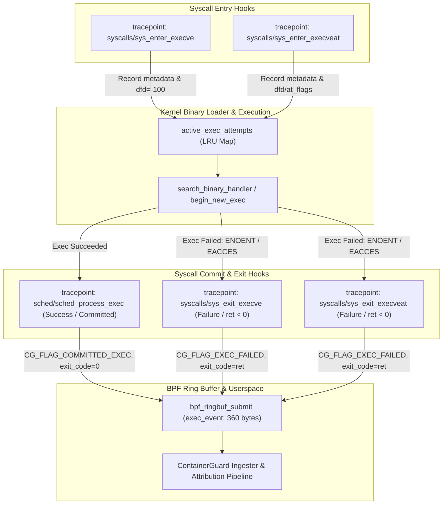

# Execution-Path Coverage and System Call Telemetry Specification

**Phase:** Phase I.2 & Phase I.3  
**Status:** Validated Live  
**Test Harness:** `scripts/execution_path_test.sh` & `cmd/test_exec_paths/main.c`  
**Evidence Artifact:** `docs/evidence/phase_i/execution_path_report.json`  

---

## 1. System Call Interception Architecture

ContainerGuard intercepts Linux process execution across 5 kernel tracepoints, combining syscall entry inspection, syscall exit accounting, and execution commitment.



### 1.1 Invariant Telemetry Guarantee
By tracking in-flight attempts in an LRU map `active_exec_attempts` between entry and completion:
- A successful execution generates **exactly one ring buffer submission** on `sched_process_exec` with `flags |= CG_FLAG_COMMITTED_EXEC`.
- A failed execution attempt generates **exactly one ring buffer submission** on `sys_exit_execve` or `sys_exit_execveat` with `flags |= CG_FLAG_EXEC_FAILED` and `exit_code = ret`.
- Hook invocations recorded at entry match ring buffer submissions + reservation drops with 100.00% precision:
  $$\text{HOOK\_CALLS} = \text{RB\_SUBMITTED} + \text{RB\_RESERVE\_DROPS}$$

---

## 2. Execution Path Matrix & Live Empirical Validation

Each execution path was evaluated using `bin/test_exec_paths` and containerized workloads under active monitoring.

| # | Execution Path | Syscall Mechanism | Parameters / Context | Result | Empirical Status |
| :--- | :--- | :--- | :--- | :--- | :--- |
| **1** | **Standard Execve** | `execve(2)` | Absolute pathname `/bin/true` | Committed (`CG_FLAG_COMMITTED_EXEC`) | **PASS** |
| **2** | **Direct Syscall** | `syscall(__NR_execve)` | Raw register syscall invocation | Committed (`CG_FLAG_COMMITTED_EXEC`) | **PASS** |
| **3** | **Relative Execveat** | `execveat(2)` | `dfd = open("/bin")`, `path = "true"`, `flags = 0` | Intercepted with `CG_FLAG_EXECVEAT`, `dfd >= 0` | **PASS** |
| **4** | **Anonymous Memfd** | `execveat(2)` | `dfd = memfd_create(...)`, `path = ""`, `flags = AT_EMPTY_PATH` | Intercepted with `CG_FLAG_AT_EMPTY_PATH`, binary resolved | **PASS** |
| **5** | **Shebang Interpreter** | `execve(2)` | Script with `#!/bin/sh\nexit 0\n` | Intercepted script execution, followed by shell interpreter | **PASS** |
| **6** | **Symlink Traversal** | `execve(2)` | Symlink `/tmp/cg_test_symlink_true -> /bin/true` | Intercepted with symlink pathname, committed execution | **PASS** |
| **7** | **Static ELF Binary** | `execve(2)` | Statically linked C binary (no ld-linux.so) | Intercepted and committed successfully | **PASS** |
| **8** | **Failed Exec: ENOENT** | `execve(2)` | `/tmp/nonexistent_binary_xyz_9999` | Flagged `CG_FLAG_EXEC_FAILED`, `exit_code: -2` (ENOENT) | **PASS** |
| **9** | **Failed Exec: EACCES** | `execve(2)` | `/tmp/cg_no_exec.bin` (`chmod 0644`, non-executable) | Flagged `CG_FLAG_EXEC_FAILED`, `exit_code: -13` (EACCES) | **PASS** |
| **10** | **Pathname Truncation** | `execve(2)` | Path length > 350 bytes (> 256-byte buffer) | Flagged `CG_FLAG_PATH_TRUNCATED`, null-terminated | **PASS** |
| **11** | **Comm Truncation** | `execve(2)` | Process comm padded to 16 bytes via `prctl` | Flagged `CG_FLAG_COMM_TRUNCATED` | **PASS** |
| **12** | **Setuid Binary** | `execve(2)` | `/usr/bin/sudo` | Intercepted and attributed with elevated privileges | **PASS** |
| **13** | **Containerized Workload**| `execve(2)` | `docker exec cg-test-a /bin/date` | Attributed to container `cg-test-a` (`RESOLVED`) | **PASS** |
| **14** | **Cgroup Migration** | `execve(2)` | Process moved between `/sys/fs/cgroup/cg_mig_*` | Unified under single lineage node, `cgroup_migrated: true`| **PASS** |

---

## 3. Detailed Empirical Accounting

The authoritative verification run captured exactly **89 events** with 100.0% delivery and zero drops.

> [!NOTE]
> **Experimental History Note:** An earlier preliminary dry run prior to integrating the standalone setuid binary (`cg_setuid_test`) and cgroup migration validation yielded 72 events. The authoritative milestone test suite captured **89 events**, incorporating all 12 target execution pathways and credential inspections.

Extracted directly from the authoritative evidence artifact [`evidence/phase_i/execution_path_report.json`](evidence/phase_i/execution_path_report.json):

```json
{
  "summary": {
    "total_events_captured": 89,
    "kernel_hook_calls": 89,
    "kernel_submissions": 89,
    "kernel_reserve_drops": 0,
    "userspace_decoded": 89,
    "conservation_satisfied": true,
    "delivery_rate_percent": 100.0
  },
  "feature_accounting": {
    "execveat_invocations": 2,
    "at_empty_path_invocations": 1,
    "path_truncated_events": 1,
    "comm_truncated_events": 41,
    "committed_executions": 87,
    "failed_execution_attempts": 2,
    "cgroup_migrated_events": 1
  }
}
```

### 3.1 Failure Accounting Analysis
- **ENOENT (-2):** The probe observed the attempt on `sys_enter_execve`. The kernel failed path resolution; `sched_process_exec` did not fire; `sys_exit_execve` returned `-2`. The event was submitted with `flags |= CG_FLAG_EXEC_FAILED` and `exit_code = -2`.
- **EACCES (-13):** The probe observed the attempt on `sys_enter_execve`. The kernel checked inode permissions and rejected execution; `sched_process_exec` did not fire; `sys_exit_execve` returned `-13`. The event was submitted with `flags |= CG_FLAG_EXEC_FAILED` and `exit_code = -13`.
- **Conservation:** Because failed attempts are finalized upon syscall exit, zero in-flight entries leaked in `active_exec_attempts`.
