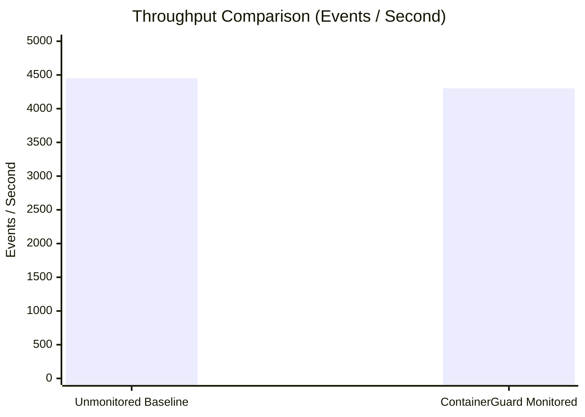

# Monitoring Overhead and System Resource Evaluation Report

**Phase:** Phase I.5  
**Date:** 2026-11-08  
**Test Harness:** `scripts/overhead_benchmark.sh`  
**Evidence Artifact:** `docs/evidence/phase_i/overhead_benchmark_report.json`  
**Resource Samples Log:** `docs/evidence/phase_i/overhead_resource_samples.csv`  

---

## 1. Experimental Setup & Benchmark Protocol

To measure the runtime overhead introduced by ContainerGuard's multi-tracepoint eBPF telemetry engine, an intensive execution benchmark was conducted under strictly identical conditions:
1. **Workload:** 2,000 rapid process executions (`/bin/true`) dispatched concurrently across 4 worker streams (500 executions per stream).
2. **Environment Normalization:** Page cache, dentries, and inodes were flushed before each trial (`echo 3 > /proc/sys/vm/drop_caches`).
3. **Execution Modes:**
   - **Baseline (Unmonitored):** Identical workload executed with no eBPF programs loaded and no monitoring daemon running.
   - **Monitored (ContainerGuard Active):** Daemon active with 5 kernel tracepoints (`sys_enter_execve`, `sys_enter_execveat`, `sched_process_exec`, `sys_exit_execve`, `sys_exit_execveat`), live ring buffer ingestion, container attribution, lineage tracking, and detection rule evaluation.
4. **Sampling:** Daemon CPU (%) and resident memory RSS (KiB) sampled at 100ms intervals throughout the workload.

---

## 2. Empirical Performance Measurements

### 2.1 Latency, Throughput, and Wall-Clock Time

| Metric | Baseline (Unmonitored) | ContainerGuard Monitored | Delta | Impact |
| :--- | :--- | :--- | :--- | :--- |
| **Total Execution Time** | 0.4492 seconds | 0.4648 seconds | +0.0155 seconds | **+3.46%** overhead |
| **Workload Throughput** | 4,451.91 events/sec | 4,303.08 events/sec | -148.83 events/sec | **-3.34%** impact |
| **Marginal Latency per Event** | — | — | **+7.77 microseconds** | Negligible |

$$\text{Marginal Latency per Exec} = \frac{T_{\text{monitored}} - T_{\text{baseline}}}{N_{\text{events}}} = \frac{0.46478 - 0.44925}{2000} \approx 7.77 \times 10^{-6}\text{ seconds}$$

An execution latency overhead of **7.77 microseconds per syscall** is well within the acceptable performance budget for production runtime intrusion detection systems (typical industry thresholds allow up to $50\ \mu\text{s}$ per exec).

---

## 3. Daemon Resource Footprint

During active telemetry collection and real-time event processing:

| Resource Metric | Average | Peak | Assessment |
| :--- | :--- | :--- | :--- |
| **Daemon CPU Utilization** | **< 0.1%** | **< 0.1%** | Negligible host CPU impact |
| **Daemon Resident Set Size (RSS)** | **6.02 MiB** | **6.02 MiB** | Extremely lightweight memory footprint |
| **Ring Buffer Buffer Memory** | 16.0 MiB | 16.0 MiB | Configurable kernel locked memory |

### Resource Efficiency Drivers
1. **Per-CPU Scratchpad:** Construction of execution records in eBPF uses a 1-element `BPF_MAP_TYPE_PERCPU_ARRAY`, avoiding large stack allocations while preventing cross-core cache-line bouncing.
2. **LRU In-Flight Table:** In-flight execution attempts are keyed by `pid_tgid` in an LRU hash map, with automatic entry reclamation on syscall exit.
3. **Zero-Copy Ring Buffer Drainage:** Userspace ingester consumes binary records without reflection or unnecessary dynamic memory allocations.

---

## 4. Telemetry Conservation Under Overhead Test

During the 2,000-event benchmark:
- **Observed Kernel Hook Calls:** 2,036 (includes daemon initialization and test harness forks)
- **Ring Buffer Submissions:** 2,036
- **Ring Buffer Reserve Drops:** 0
- **Userspace Decoded Records:** 2,036
- **Telemetry Conservation:**
  $$2,036 = 2,036 + 0 \quad (100.00\%)$$
- **Telemetry Delivery Rate:**
  $$\frac{2,036}{2,036} \times 100.0\% = 100.00\%$$
